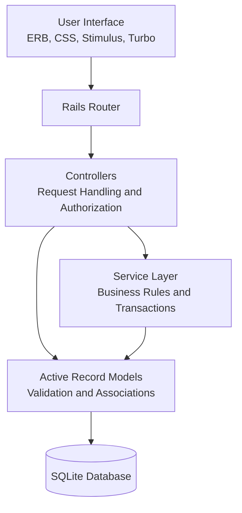
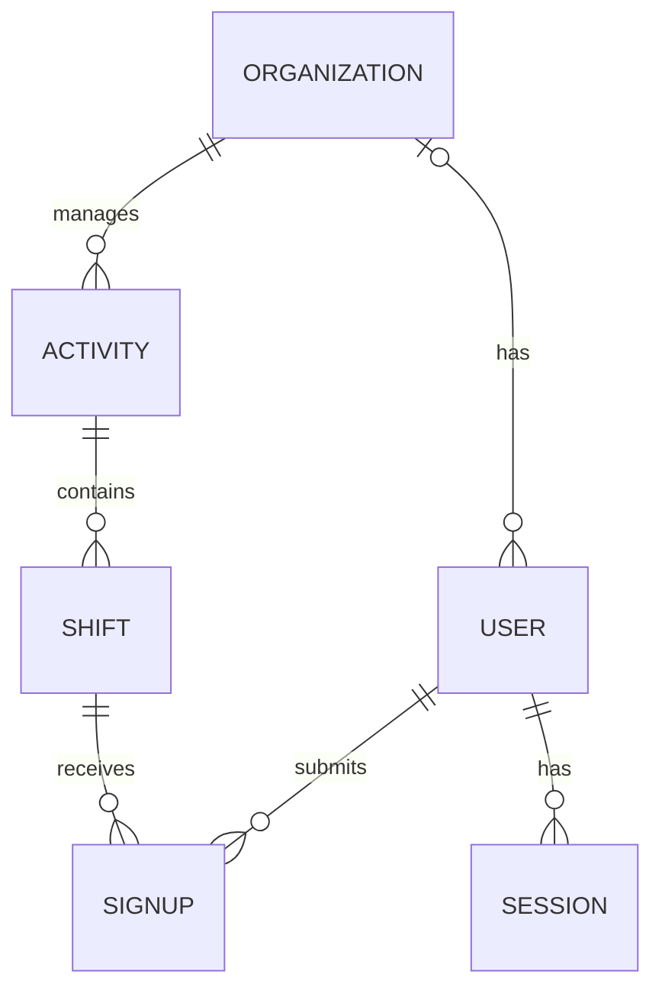
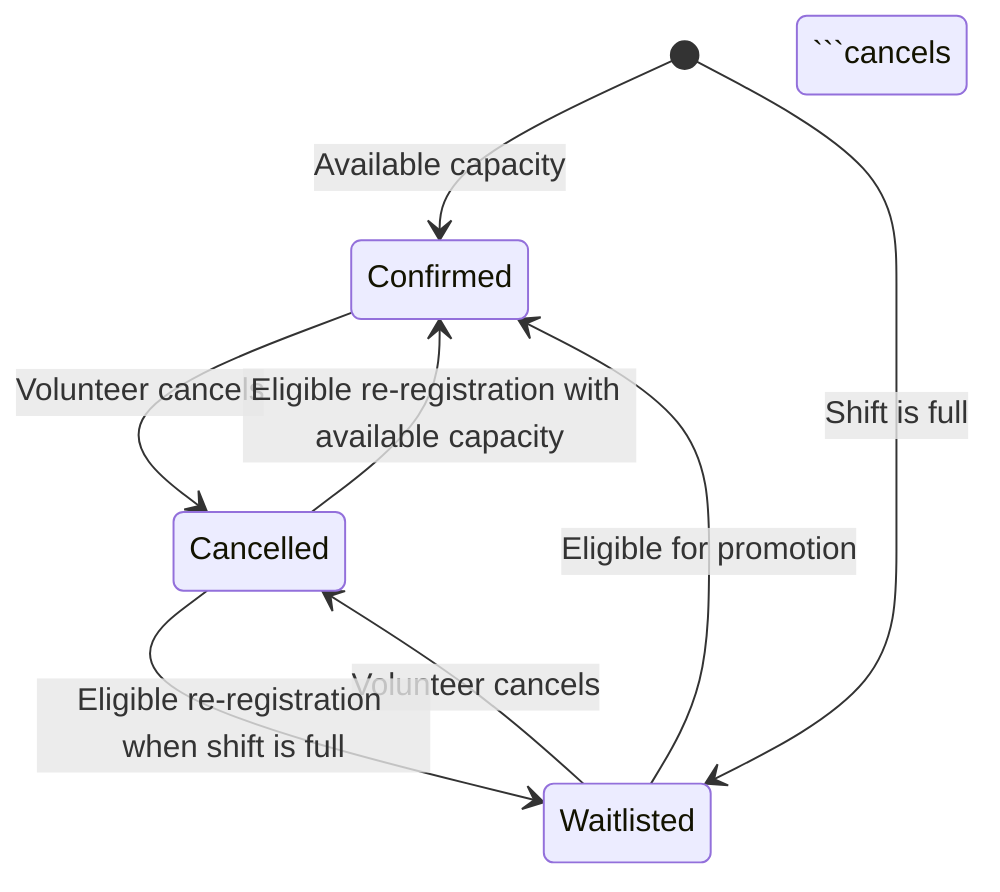
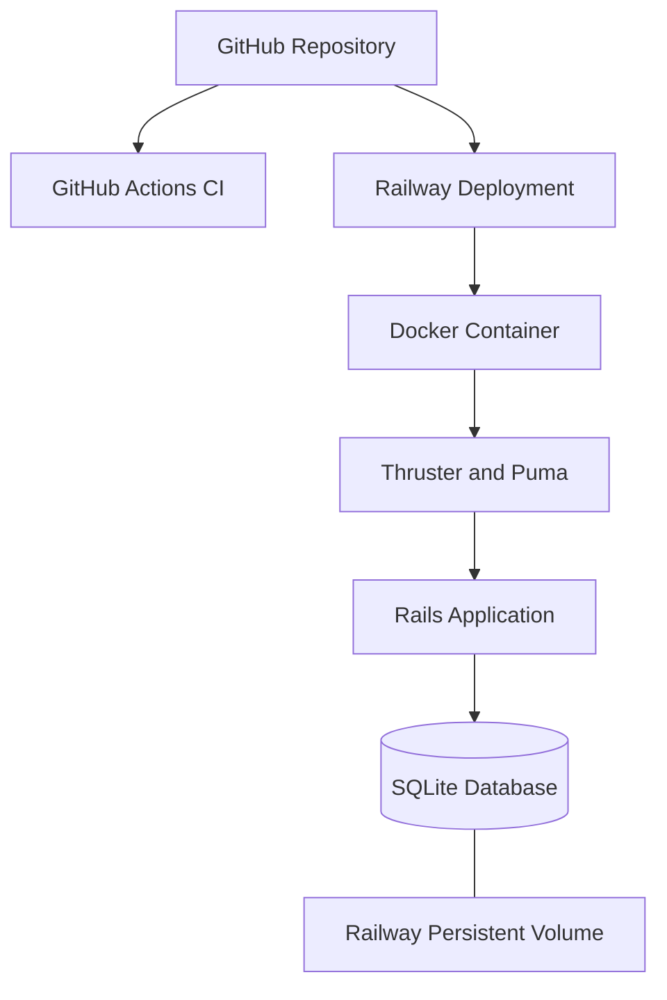
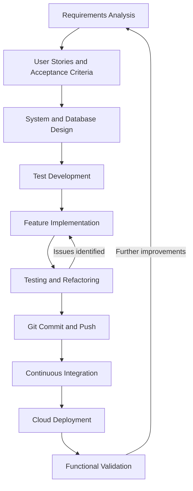

# VolunteerHub

**CSCI3100 Course Project | 2026–2027 Term 1**

**Option E: CUHK Volunteer Coordination**

## Table of Contents

1. [Project Overview](#1-project-overview)
2. [Team Information](#2-team-information)
3. [Implemented Features](#3-implemented-features)
4. [Core Business Rules](#4-core-business-rules)
5. [Technology Stack](#5-technology-stack)
6. [System Architecture](#6-system-architecture)
7. [Live Deployment](#7-live-deployment)
8. [Demo Accounts and Data](#8-demo-accounts-and-data)
9. [Local Installation and Setup](#9-local-installation-and-setup)
10. [Automated Testing and Code Quality](#10-automated-testing-and-code-quality)
11. [Development Process and CI/CD](#11-development-process-and-cicd)
12. [Known Limitations](#12-known-limitations)
13. [Acknowledgements and AI Assistance](#13-acknowledgements-and-ai-assistance)

## 1. Project Overview

VolunteerHub is a web-based volunteer coordination and management system designed for student organizations at The Chinese University of Hong Kong (CUHK).

The system provides a centralized platform for student organizations to publish volunteer activities, schedule shifts, manage volunteer registrations, and track attendance. Volunteers can browse available activities, sign up for shifts, join waiting lists, cancel registrations, and view their participation records.

VolunteerHub aims to address common challenges in manual volunteer coordination, including:

- Overbooking and inefficient capacity management.
- Scheduling conflicts between volunteer shifts.
- Manual waiting list management.
- Inconsistent attendance tracking.
- Insufficient separation of administrative permissions between organizations.

To address these challenges, the system implements automated capacity enforcement, scheduling conflict detection, FIFO waiting lists, automatic volunteer promotion, role-based access control, and organization-level data isolation.

The project emphasizes software reliability, maintainability, usability, and engineering quality through iterative development, automated testing, continuous integration, and cloud deployment.

> **Disclaimer:** VolunteerHub is developed solely for educational purposes as a CSCI3100 course project. It is not an official CUHK service and uses synthetic demonstration data.

## 2. Team Information

| Item | Details |
| --- | --- |
| Course | CSCI3100 |
| Academic Year | 2026–2027, Term 1 |
| Project Topic | Option E: CUHK Volunteer Coordination |
| Development Mode | Solo Project |
| Team Size | 1 |
| Developer | Tan Yuanzhe |
| GitHub Repository | [CSCI3100-Project](https://github.com/TonyTan06/CSCI3100-Project) |

This project was developed as an individual course project. The developer is responsible for requirements analysis, system design, implementation, automated testing, deployment, and documentation.

## 3. Implemented Features

### 3.1 Account Management

- User registration, login, and logout.
- Password reset mechanism.
- Secure password storage using BCrypt.
- Role-based access control for volunteers and organizers.
- Organization-based access restrictions for organizers.
- Quick login options for demonstration accounts.

### 3.2 Volunteer Features

- Browse volunteer activities across all organizations.
- Search activities by title and location.
- Browse all volunteer shifts across organizations,
  including full shifts with waiting lists.
- View activity details, shift schedules, capacity, and remaining spaces.
- Sign up for volunteer shifts.
- Join the waiting list when a shift reaches its capacity.
- Cancel existing confirmed or waitlisted registrations.
- Automatically receive a confirmed place when eligible for waiting list promotion.
- View personal signup history and registration status.
- View personal attendance records.
- Access a personalized dashboard displaying confirmed, waitlisted, and cancelled signups.

### 3.3 Organizer Features

- Create and edit volunteer activities within the organizer's own organization.
- Create, edit, and delete volunteer shifts, subject to business rules.
- Configure shift start times, end times, and capacity.
- Browse and manage shifts belonging to the organizer's own organization.
- View confirmed signup counts, available spaces, and waiting list counts.
- Manage attendance records for confirmed volunteers.
- Update attendance status to Pending, Present, or Absent.
- Monitor shift capacity utilization.
- Access an organization dashboard displaying activity, shift, signup, and attendance statistics.

### 3.4 User Interface and Usability

- Consistent visual design with a unified purple color theme.
- Role-specific sidebar navigation and dashboards.
- Card-based activity, shift, and signup listings.
- Visual progress bars for shift capacity utilization.
- Status badges for registration, availability, and attendance.
- Clear success messages, error messages, and validation feedback.
- Confirmation prompts for destructive operations.
- Explanatory messages for restricted operations.
- Empty-state messages when no records are available.

## 4. Core Business Rules

VolunteerHub implements the following business rules to ensure data integrity, fair volunteer allocation, and secure access control. These rules are enforced on the server side rather than relying solely on user interface restrictions.

### 4.1 Shift Capacity Enforcement

- Every shift must have a positive integer capacity.
- The number of confirmed volunteers must not exceed the shift's capacity.
- When a shift reaches its capacity, additional eligible volunteers are placed on the waiting list.
- Organizers cannot reduce a shift's capacity below its current number of confirmed volunteers.

### 4.2 Scheduling Conflict Prevention

- A volunteer cannot hold confirmed registrations for overlapping shifts.
- Scheduling conflicts are checked when processing volunteer signups and waiting list promotions.
- Organizers cannot modify shift times if the modification would introduce scheduling conflicts for existing confirmed volunteers.
- The end time of a shift must be later than its start time.

### 4.3 Waiting List Management

- Waiting lists follow the First-In, First-Out (FIFO) principle based on the time each volunteer joins the waiting list.
- When a confirmed volunteer cancels their registration, the system automatically attempts to promote the next eligible volunteer.
- Volunteers with conflicting confirmed shifts are skipped during promotion.
- A volunteer is promoted only when sufficient capacity is available.
- Waiting list promotion is performed automatically without requiring manual organizer intervention.

### 4.4 Signup and Cancellation Management

- Duplicate registrations for the same volunteer and shift are prevented.
- Volunteers can cancel their own confirmed or waitlisted registrations.
- Volunteers cannot cancel registrations belonging to other users.
- Cancelled registrations are retained in the database
  rather than being immediately deleted.
- Registration status is represented by three states: Confirmed, Waitlisted, and Cancelled.

### 4.5 Attendance Management

- Only confirmed volunteers are eligible for attendance management.
- Attendance status is represented by three states: Pending, Present, and Absent.
- Only authorized organizers belonging to the shift's organization can modify attendance records.
- Volunteers can view their own attendance status but cannot modify it.

### 4.6 Organization Isolation and Authorization

- Volunteers can browse activities and shifts across all organizations.
- Organizers can only manage activities, shifts, and attendance records belonging to their own organization.
- Volunteers cannot access organizer-only management functions.
- Unauthorized access is restricted even when users attempt to access resources through direct URLs or manually constructed HTTP requests.
- Resources outside an organizer's authorized organization scope return HTTP 404 responses.
- Forbidden role-based operations return HTTP 403 responses.

### 4.7 Shift Deletion and Historical Data Protection

- Only authorized organizers can delete shifts belonging to their own organization.
- A shift can be deleted only when it has no existing signup records.
- Shifts containing confirmed, waitlisted, or cancelled registrations cannot be deleted.
- This restriction protects historical volunteer participation and attendance records.
- Deletion restrictions are enforced through service-level checks and model associations.

### 4.8 Data Validation and Transaction Management

- Required fields, valid time ranges, and numerical constraints are validated before records are saved.
- Database relationships and foreign key constraints protect referential integrity.
- Critical business operations use database transactions to maintain consistent application state.
- Invalid operations are rejected with appropriate feedback without applying the requested invalid changes.

## 5. Technology Stack

### 5.1 Runtime Environment

| Technology | Version |
| --- | --- |
| Ruby | 3.4.13 |
| Ruby on Rails | 8.1.4.1 |
| Bundler | 2.6.9 |
| SQLite (Local Environment) | 3.54.1 |

### 5.2 Backend

| Technology | Purpose |
| --- | --- |
| Ruby | Primary programming language |
| Ruby on Rails | Web application framework |
| Active Record | Object-relational mapping and database operations |
| SQLite | Relational database and persistent data storage |
| BCrypt | Secure password hashing |
| Rails Authentication | User authentication and session management |
| Puma | Application web server |

### 5.3 Frontend

| Technology | Purpose |
| --- | --- |
| HTML5 | Web page structure |
| ERB | Server-side HTML rendering |
| CSS | Interface styling and visual design |
| JavaScript | Client-side interactions |
| Stimulus | JavaScript controllers and interactive components |
| Turbo | Navigation and form interaction |
| Importmap | JavaScript dependency management |
| Propshaft | Asset management and delivery |

### 5.4 Testing and Code Quality

| Technology | Purpose |
| --- | --- |
| RSpec | Model, service, and request testing |
| Cucumber | Behavior-driven acceptance testing |
| Capybara | Web application acceptance testing |
| Database Cleaner | Test database isolation |
| SimpleCov | Code coverage measurement and reporting |
| RuboCop | Ruby code style and static analysis |
| Brakeman | Static security analysis for Rails applications |
| Bundler Audit | Ruby dependency vulnerability scanning |
| Importmap Audit | JavaScript dependency vulnerability scanning |

### 5.5 Version Control and Deployment

| Technology | Purpose |
| --- | --- |
| Git | Version control and development history |
| GitHub | Source code repository |
| GitHub Actions | Automated testing, linting, and security checks |
| Docker | Consistent production container environment |
| Thruster | HTTP acceleration and asset delivery |
| Railway | Cloud application hosting and deployment |
| Railway Persistent Volume | Persistent SQLite database storage |

The technology stack was selected to support rapid development,
maintainability, automated testing, reproducible deployment, and
reliable implementation of the project's core business requirements.

## 6. System Architecture

VolunteerHub follows the Model-View-Controller (MVC) architecture
provided by Ruby on Rails, with an additional service layer to
encapsulate complex business logic.

This architecture separates presentation, request handling, business
operations, and data persistence, improving maintainability,
testability, and separation of responsibilities.

### 6.1 Application Architecture



The application is organized into the following layers:

| Layer | Responsibility |
| --- | --- |
| View | Renders the user interface and presents application data |
| Router | Maps incoming HTTP requests to controller actions |
| Controller | Handles requests, authentication, authorization, and responses |
| Service | Encapsulates complex business operations and business rules |
| Model | Defines data relationships, validations, and persistence logic |
| Database | Provides persistent relational data storage |

### 6.2 Service Layer

Complex business operations are separated from controllers into
dedicated service classes.

| Service | Responsibility |
| --- | --- |
| ActivityService | Processes activity management operations |
| ShiftCreateService | Handles shift creation and validation |
| ShiftUpdateService | Handles shift updates and protects existing registrations |
| ShiftDestroyService | Enforces shift deletion permissions and historical data protection |
| SignupService | Processes volunteer signups, capacity restrictions, and scheduling conflicts |
| CancellationService | Handles registration cancellation and initiates waiting list promotion |
| WaitlistService | Manages waiting list ordering and eligible volunteer promotion |
| AttendanceService | Handles authorized attendance updates |

The service layer allows business rules to be tested independently
from HTTP requests and user interface components. Critical operations
use database transactions to maintain data consistency.

### 6.3 Database Design

The application uses SQLite as its relational database and Active
Record to manage database interactions and entity relationships.

The following diagram illustrates the main application entities
and their relationships.



| Entity | Responsibility |
| --- | --- |
| Organization | Represents an independent student organization |
| User | Stores user account information, role, and organization membership where applicable |
| Activity | Represents a volunteer activity managed by an organization |
| Shift | Defines the schedule and capacity of a volunteer session |
| Signup | Records a volunteer's registration, waiting list information, and attendance status |
| Session | Stores authenticated user session information |

Organizers are associated with their respective organizations,
while volunteers can participate in activities across organizations.

The Signup entity connects volunteers with shifts and maintains
both registration status and attendance status.

### 6.4 Registration and Attendance States

The registration lifecycle is represented by three states.



Attendance is tracked separately from registration status.

| State Type | Supported States |
| --- | --- |
| Registration | Confirmed, Waitlisted, Cancelled |
| Attendance | Pending, Present, Absent |

This separation allows the application to manage volunteer
participation and attendance independently while preserving
historical registration records.

### 6.5 Authorization and Data Isolation

Authentication and authorization are enforced on the server side.

Controllers restrict access according to the authenticated user's
role and organization membership. Protected service operations
also perform relevant authorization and business-rule checks.

Database associations, model validations, and foreign key
constraints provide additional protection for data integrity.

This layered approach ensures that restricted operations cannot
be performed simply by bypassing user interface controls.

## 7. Live Deployment

### 7.1 Application URL

VolunteerHub is deployed on Railway and is accessible through
the following public URL:

**Live Application:**
https://csci3100-project-production.up.railway.app/

The deployed application allows users to access the system
directly through a web browser without installing any local
dependencies.

Demonstration accounts are available for both volunteer and
organizer roles, as described in Section 8.

### 7.2 Deployment Architecture



The production environment uses Docker to package the application
and its runtime dependencies. Railway provides cloud hosting,
application deployment, and persistent storage.

### 7.3 Database Persistence

The production SQLite database is stored on a Railway Persistent
Volume mounted at `/rails/storage`.

This configuration allows application data to remain available
across application restarts and redeployments, including:

- User accounts and organization records.
- Volunteer activities and shifts.
- Confirmed, waitlisted, and cancelled registrations.
- Volunteer attendance records.

Database persistence has been verified by restarting the deployed
application and confirming that existing records remain available.

### 7.4 Deployment Workflow

The application is connected to its GitHub repository through
Railway.

The deployment workflow consists of the following steps:

1. Implement and test changes in the local development environment.
2. Commit changes using Git.
3. Push the changes to the main branch on GitHub.
4. Run automated tests, security checks, and code quality checks
   through GitHub Actions.
5. Deploy the updated application through Railway.
6. Perform functional verification on the deployed application.

Railway supports automatic deployment from GitHub and manual
deployment of the latest commit.

### 7.5 Production Configuration

- HTTPS is enabled for the deployed application.
- Production secrets are managed through environment variables.
- Sensitive credentials are not committed to the GitHub repository.
- Database preparation is performed during application startup.
- Persistent storage is maintained independently of the application
  container.

### 7.6 Deployment Verification

The deployed application has been manually tested to verify:

- User authentication and demonstration account access.
- Volunteer registration and cancellation workflows.
- Shift capacity enforcement.
- Waiting list management and automatic promotion.
- Scheduling conflict prevention.
- Activity and shift management.
- Shift deletion and historical data protection.
- Attendance management.
- Server-side role restrictions and organization isolation.
- Database persistence across application restarts.

The deployed application is intended for educational demonstration
and course assessment purposes only.

## 8. Demo Accounts and Data

### 8.1 Demonstration Accounts

The application provides four predefined demonstration accounts
covering both user roles and two independent organizations.

| Email Address | Role | Organization |
| --- | --- | --- |
| volunteer1@example.com | Volunteer | N/A |
| volunteer2@example.com | Volunteer | N/A |
| organizer1@example.com | Organizer | CUHK Volunteer Team |
| organizer2@example.com | Organizer | CUHK Community Service |

**Password for all demonstration accounts:** `password123`

The login page provides quick-fill buttons for all four
demonstration accounts, allowing users to access the system
without manually entering account credentials.

All demonstration accounts are fictional and are provided
exclusively for educational testing and assessment purposes.

### 8.2 Demonstration Organizations and Activities

The application includes two independent organizations and
three predefined volunteer activities.

| Organization | Activity |
| --- | --- |
| CUHK Volunteer Team | Campus Cleanup |
| CUHK Volunteer Team | Library Support |
| CUHK Community Service | Community Tutoring |

These organizations demonstrate the separation of administrative
permissions and organization-specific resources.

Volunteers can participate in activities across both organizations,
while organizers can only manage resources belonging to their
own organization.

### 8.3 Demonstration Shifts

The database seed includes the following five volunteer shifts.

| Activity | Date | Start Time | End Time | Capacity |
| --- | --- | --- | --- | --- |
| Campus Cleanup | 2027-01-12 | 09:00 | 12:00 | 1 |
| Campus Cleanup | 2027-01-13 | 14:00 | 17:00 | 5 |
| Library Support | 2027-01-14 | 10:00 | 12:00 | 4 |
| Community Tutoring | 2027-01-15 | 09:00 | 12:00 | 3 |
| Community Tutoring | 2027-01-16 | 14:00 | 17:00 | 5 |

The initial seed data includes confirmed registrations,
waitlisted registrations, and attendance records.

The Campus Cleanup shift with a capacity of one is specifically
designed to demonstrate capacity enforcement, waiting list
management, and automatic volunteer promotion.

### 8.4 Suggested Demonstration Scenarios

The following scenarios can be used to explore and evaluate
the application's core functionality.

| Scenario | Suggested Role | Expected Behavior |
| --- | --- | --- |
| Browse activities and shifts | Volunteer | View resources across both organizations |
| Sign up for an available shift | Volunteer | Receive a confirmed registration |
| Sign up for a full shift | Volunteer | Join the waiting list |
| Cancel a confirmed registration | Volunteer | Trigger promotion of the next eligible waitlisted volunteer |
| Sign up for overlapping shifts | Volunteer | Reject conflicting registrations |
| Create or edit an activity | Organizer | Manage activities within the organizer's own organization |
| Create or edit a shift | Organizer | Configure shift schedules and capacity |
| Delete a shift without signup records | Organizer | Successfully remove the shift |
| Delete a shift with signup history | Organizer | Reject deletion and preserve historical records |
| Update attendance status | Organizer | Update the attendance of confirmed volunteers |
| Access another organization's management resources | Organizer | Reject unauthorized access |
| Access organizer-only functions | Volunteer | Reject unauthorized access |

Some scenarios may require creating additional temporary shifts
or adjusting existing demonstration registrations.

### 8.5 Demonstration Data Persistence

The deployed application uses a persistent database. Changes
made during demonstrations, including registrations, cancellations,
attendance updates, and activity management operations, are retained.

Therefore, the current state of the deployed demonstration data
may differ from the original seed data.

A fresh local installation can reproduce the initial demonstration
dataset using the database setup and seeding instructions
provided in Section 9.

## 9. Local Installation and Setup

### 9.1 Prerequisites

Before running the application locally, ensure that the following
tools are installed:

| Requirement | Version or Description |
| --- | --- |
| Git | Required for cloning the repository |
| Ruby | 3.4.13 |
| Bundler | 2.6.9 |
| Ruby on Rails | 8.1.4.1, installed through Bundler |
| SQLite | Local development and test database |
| Web Browser | A modern web browser |

A Ruby version manager, such as rbenv, is recommended for
installing and managing the required Ruby version.

The application uses Importmap and Propshaft for frontend
dependency and asset management. Node.js and npm are not
required for the standard application setup.

### 9.2 Clone the Repository

Clone the GitHub repository and enter the project directory.

```bash
git clone https://github.com/TonyTan06/CSCI3100-Project.git
cd CSCI3100-Project
```

To reproduce the submitted version, check out the commit SHA
specified in the final submission.

### 9.3 Verify the Ruby Environment

Verify that the required Ruby and Bundler versions are installed.

```bash
ruby -v
bundle -v
```

If Bundler 2.6.9 is not installed, run:

```bash
gem install bundler -v 2.6.9
```

### 9.4 Install Dependencies

Install the dependencies specified in the Gemfile and Gemfile.lock.

```bash
bundle install
```

Verify the installed Rails version.

```bash
bundle exec rails -v
```

Depending on the operating system, additional system libraries
may be required.

For Ubuntu or Debian-based environments:

```bash
sudo apt-get update
sudo apt-get install -y build-essential libsqlite3-dev libvips
```

For macOS using Homebrew:

```bash
brew install sqlite3 vips
```

### 9.5 Prepare and Seed the Database

Prepare the local development database and load the predefined
demonstration data.

```bash
bin/rails db:prepare
bin/rails db:seed
```

The database seed provides:

- Two demonstration organizations.
- Four demonstration user accounts.
- Three volunteer activities.
- Five volunteer shifts.
- Sample confirmed and waitlisted registrations.
- Sample attendance records.

The demonstration accounts are listed in Section 8.

### 9.6 Start the Application

Start the Rails development server.

```bash
bin/rails server
```

Open the following URL in a web browser:

http://localhost:3000

The application can now be accessed using the predefined
demonstration accounts.

To stop the development server, press `Ctrl+C` in the terminal.

### 9.7 Automated Setup

Alternatively, the application provides a setup script that
automates dependency installation and database preparation.

```bash
bin/setup --skip-server
```

The setup script performs the following operations:

1. Checks and installs required Ruby dependencies.
2. Prepares the database.
3. Clears old logs and temporary files.

After completing the automated setup, ensure that the
demonstration data has been seeded and start the application.

```bash
bin/rails db:seed
bin/rails server
```

### 9.8 Reset Local Demonstration Data

To restore the local development database to its initial
demonstration state, run:

```bash
RAILS_ENV=development bin/rails db:reset
```

This command recreates the local development database and
loads the seed data.

**Warning:** This operation deletes existing records from the
target development database. It must only be used when
resetting local demonstration or development data.

Do not execute database reset commands against the deployed
production database.

### 9.9 Prepare the Test Environment

Prepare the test database before running automated tests.

```bash
RAILS_ENV=test bin/rails db:test:prepare
```

Detailed instructions for running RSpec, Cucumber, coverage
reports, and code quality checks are provided in Section 10.

### 9.10 Environment Configuration

The standard local development environment does not require
access to the Railway production database or production secrets.

Production credentials, encryption keys, and other sensitive
configuration values must remain outside the source code
repository.

The local application uses its own SQLite database, allowing
development, testing, and demonstration activities to be
performed independently of the deployed application.

## 10. Automated Testing and Code Quality

VolunteerHub uses automated testing to verify application
functionality, business rules, data integrity, authorization,
and organization isolation.

The testing strategy combines RSpec and Cucumber to provide
coverage at different levels of the application.

### 10.1 Testing Strategy

| Test Type | Framework | Purpose |
| --- | --- | --- |
| Model Tests | RSpec | Verify model validations, associations, and data constraints |
| Service Tests | RSpec | Verify business logic and transaction-based operations |
| Request Tests | RSpec | Verify HTTP responses, authentication, authorization, and application workflows |
| User Interface Tests | RSpec and Nokogiri | Verify rendered page content, navigation, and interface restrictions |
| Acceptance Tests | Cucumber and Capybara | Verify user stories and expected application behavior |

The combination of these testing approaches allows individual
components and complete application workflows to be verified.

### 10.2 Business Rule Testing

Automated tests cover the following major areas:

- User registration, authentication, and account management.
- Role-based authorization.
- Organization-level data isolation.
- Activity creation, editing, searching, and listing.
- Shift creation, editing, deletion, and listing.
- Shift capacity enforcement.
- Scheduling conflict detection.
- Duplicate signup prevention.
- Waiting list ordering and automatic promotion.
- Registration cancellation.
- Attendance management and authorization.
- Historical signup and attendance data protection.
- Dashboard statistics and navigation.
- Invalid operations and unauthorized HTTP requests.

Both successful operations and invalid scenarios are tested
to verify that the application behaves correctly under
different conditions.

### 10.3 Test Results

The latest complete local regression test produced the
following results:

| Metric | Result |
| --- | --- |
| RSpec Examples | 445 |
| RSpec Failures | 0 |
| Cucumber Scenarios | 7 |
| Passed Cucumber Scenarios | 7 |
| Cucumber Steps | 32 |
| Passed Cucumber Steps | 32 |
| Application Line Coverage | 89.31% |
| Covered Lines | 493 / 552 |
| Required Minimum Coverage | 80% |
| RuboCop Files Inspected | 104 |
| RuboCop Offenses | 0 |

All RSpec examples and Cucumber scenarios passed successfully.

The application exceeds the required minimum line coverage
by 9.31 percentage points.

### 10.4 Behavior-Driven Acceptance Tests

Cucumber acceptance tests are written in Gherkin to describe
application behavior from the user's perspective.

The project includes the following seven acceptance scenarios:

| Feature | Scenario |
| --- | --- |
| Organization Isolation for Attendance | Organizer cannot view another organization's attendance |
| Organization Isolation for Attendance | Organizer can view their own organization's attendance |
| Organization Isolation for Attendance | Volunteer cannot access attendance management |
| Volunteer Signup | Successfully sign up for an available shift |
| Volunteer Signup | Join the waitlist when a shift is full |
| Volunteer Signup | Promote a waitlisted volunteer after cancellation |
| Volunteer Signup | Reject signup for an overlapping shift |

These scenarios verify the main volunteer workflow and
important business and authorization restrictions.

### 10.5 Running Automated Tests

Prepare the test database before running the test suites.

```bash
RAILS_ENV=test bin/rails db:test:prepare
```

Run all RSpec tests:

```bash
bundle exec rspec
```

Run all Cucumber acceptance tests:

```bash
bundle exec cucumber --publish-quiet
```

Alternatively, execute both test suites consecutively:

```bash
bundle exec rspec && bundle exec cucumber --publish-quiet
```

### 10.6 Code Coverage

SimpleCov is used to measure application line coverage.

The shared coverage configuration is defined in `.simplecov`.

```ruby
SimpleCov.cover "app/**/*.rb"
SimpleCov.coverage_dir "coverage"
SimpleCov.minimum_coverage 80
```

The coverage configuration includes Ruby application files
that may not be loaded during individual tests, ensuring
that untested application files are included in the report.

RSpec and Cucumber coverage results are combined when both
test suites are executed consecutively within the configured
coverage merge time window.

To reproduce the complete coverage report, run:

```bash
bundle exec rspec && bundle exec cucumber --publish-quiet
```

The generated HTML coverage report is available at:

```text
coverage/index.html
```

Open this file in a web browser to inspect application
coverage at the file and line levels.

The current application line coverage is **89.31%**,
exceeding the minimum requirement of **80%**.

Running only an individual test file may produce a lower
coverage percentage because the remaining application
components are not exercised. The coverage requirement
should be evaluated using the complete test suites.

### 10.7 Code Quality

RuboCop is used to enforce consistent Ruby coding conventions
and identify code style issues.

Run the complete code quality check with:

```bash
bundle exec rubocop
```

The latest complete inspection reported:

```text
104 files inspected, no offenses detected
```

### 10.8 Security Checks

The project includes automated security and dependency
vulnerability checks.

| Tool | Purpose |
| --- | --- |
| Brakeman | Static security analysis of the Rails application |
| Bundler Audit | Detection of known vulnerabilities in Ruby dependencies |
| Importmap Audit | Detection of known vulnerabilities in JavaScript dependencies |

These checks can be executed locally using:

```bash
bin/brakeman --no-pager
bin/bundler-audit
bin/importmap audit
```

Automated tests, code quality checks, and security checks
are also integrated into the GitHub Actions CI workflow.

### 10.9 Test Directory Structure

```text
spec/
├── models/
├── services/
└── requests/

features/
├── attendance_access.feature
├── volunteer_signup.feature
└── step_definitions/
```

- `spec/models/` contains model-level tests.
- `spec/services/` contains business logic and service tests.
- `spec/requests/` contains HTTP request, authorization,
  integration, and rendered interface tests.
- `features/` contains Gherkin acceptance scenarios.
- `features/step_definitions/` contains the implementations
  of Cucumber scenario steps.

This organization separates tests according to their
responsibilities and supports incremental development,
regression testing, and future maintenance.

## 11. Development Process and CI/CD

### 11.1 Iterative Development Approach

VolunteerHub was developed using an incremental and iterative
development approach. The application was divided into smaller
functional modules, allowing individual features to be implemented,
tested, and integrated progressively.

The development process consisted of the following stages:

1. Analyze project requirements and identify user stories.
2. Define acceptance criteria and business rules.
3. Design the required database models and application components.
4. Develop automated tests for expected behavior and invalid operations.
5. Implement application functionality.
6. Run tests and resolve identified issues.
7. Refactor code and perform regression testing.
8. Commit and push changes to GitHub.
9. Verify continuous integration results.
10. Deploy the application and perform functional validation.



This approach supports continuous improvement while reducing
the risk of introducing regressions into previously implemented
functionality.

### 11.2 Test-Driven Development Example

The implementation of shift deletion provides a practical
example of Test-Driven Development (TDD) in this project.

#### User Story

As an organizer, I want to delete an unnecessary shift belonging
to my organization so that I can maintain accurate activity
schedules without compromising existing volunteer records.

#### Acceptance Criteria

- An authorized organizer can delete a shift belonging to their
  own organization if it has no signup records.
- Volunteers cannot delete shifts.
- Organizers cannot delete shifts belonging to another organization.
- Shifts with confirmed, waitlisted, or cancelled signup records
  cannot be deleted.
- Existing registration and attendance records must be preserved.
- The user interface must communicate deletion restrictions clearly.

#### Red: Write Failing Tests

The initial service-level tests were written before the
`ShiftDestroyService` implementation was available.

The tests defined the expected behavior for authorized deletion,
unauthorized access, organization isolation, and deletion
restrictions.

The initial test execution failed because the required service
had not yet been implemented.

#### Green: Implement the Required Functionality

The `ShiftDestroyService` was implemented to satisfy the
defined test cases.

The implementation includes:

- Role-based authorization checks.
- Organization ownership validation.
- Existing signup record checks.
- Transaction-based deletion.
- Appropriate error handling.

After implementation, the service-level tests passed.

#### Refactor and Integration

Additional protection was implemented through Active Record
associations using `dependent: :restrict_with_error`.

The deletion functionality was integrated with Rails routes,
controller actions, and the shift detail page.

The user interface includes a deletion confirmation prompt
and disables deletion when historical signup records exist.

Additional model, request, and rendered interface tests were
introduced to verify the complete deletion workflow.

#### Testing Evidence

| Test Category | Test File | Examples |
| --- | --- | ---: |
| Service | `spec/services/shift_destroy_service_spec.rb` | 4 |
| Model | `spec/models/shift_destroy_spec.rb` | 5 |
| Request | `spec/requests/shift_destroy_spec.rb` | 9 |
| User Interface | `spec/requests/shift_destroy_ui_spec.rb` | 6 |
| **Total** | | **24** |

All 24 shift deletion tests passed successfully.

The complete regression test suite was subsequently executed
to ensure that the new functionality did not introduce
regressions into existing application features.

### 11.3 Behavior-Driven Development Example

Behavior-Driven Development (BDD) is used to describe and
verify application behavior from the user's perspective.

A representative example is the automatic promotion of a
waitlisted volunteer after a confirmed volunteer cancels
their registration.

#### User Story

As a waitlisted volunteer, I want to be automatically promoted
when an eligible place becomes available so that I do not need
to repeatedly check the shift or contact an organizer.

#### Acceptance Scenario

The following Gherkin scenario is implemented in
`features/volunteer_signup.feature`.

```gherkin
Scenario: Promote a waitlisted volunteer after cancellation
  Given I am logged in as a volunteer
  And there is a shift with an available spot
  And the shift has reached capacity
  When I join the waitlist
  And a confirmed volunteer cancels their signup
  Then my signup should be promoted to confirmed
```

This scenario connects the user story directly to the
application's expected behavior.

The implementation involves the following components:

| Component | Responsibility |
| --- | --- |
| SignupService | Processes volunteer registrations and waiting list placement |
| CancellationService | Processes cancellations and initiates waiting list promotion |
| WaitlistService | Identifies and promotes the next eligible waitlisted volunteer |
| Signup Model | Stores registration status and waiting list information |
| Shift Model | Provides shift capacity and availability information |

The acceptance test verifies that these components work
together to complete the expected user workflow.

### 11.4 Version Control

Git is used to maintain the development history of the
application, while GitHub provides remote source code storage.

Changes are organized into incremental commits representing
feature implementation, automated testing, bug fixes,
refactoring, and documentation updates.

Descriptive commit messages are used to identify the purpose
of each development iteration.

The Git history provides a record of the application's
progress from initial project setup to the completed
and deployed system.

### 11.5 Continuous Integration

GitHub Actions is used to automate application verification
when changes are pushed to the main branch or submitted
through pull requests.

The CI configuration is defined in:

`.github/workflows/ci.yml`

The workflow consists of four jobs.

| CI Job | Description |
| --- | --- |
| scan_ruby | Performs Rails static security analysis and Ruby dependency vulnerability checks |
| scan_js | Checks JavaScript dependencies for known security vulnerabilities |
| lint | Verifies Ruby code style using RuboCop |
| test | Prepares the test database and executes RSpec and Cucumber test suites |

The test job also generates SimpleCov coverage results and
enforces the configured minimum line coverage requirement
of 80%.

### 11.6 Continuous Deployment

The Railway application is connected to the GitHub repository,
allowing updated application versions to be deployed from
the main branch.

The deployment process uses Docker to construct a consistent
production environment.

Following deployment, manual functional verification is
performed to confirm that core application workflows,
authorization restrictions, and database persistence
operate as expected.

### 11.7 Development and CI Evidence

- GitHub Repository:
  https://github.com/TonyTan06/CSCI3100-Project

- GitHub Actions:
  https://github.com/TonyTan06/CSCI3100-Project/actions

- Verified CI Run:
  [Successful CI Run](https://github.com/TonyTan06/CSCI3100-Project/actions/runs/45368405908)
- Verified Commit:
  `ae3c59e550afaa40d2752522b5e5208345dd510f`

- Live Application:
  https://csci3100-project-production.up.railway.app/

The exact submitted commit SHA and its corresponding
successful CI run will be identified in the final
submission materials.

## 12. Known Limitations

VolunteerHub satisfies the core requirements of Option E and
provides a complete volunteer coordination workflow. However,
as a course project, the application has certain limitations
and areas for future improvement.

### 12.1 Database Scalability

The application currently uses SQLite for both local development
and production data storage.

While SQLite is suitable for the current project scope and
demonstration environment, the application has not been
evaluated under large-scale concurrent usage.

A future production-oriented version could migrate to
PostgreSQL and undergo additional performance and concurrency
testing.

### 12.2 Organization Management

The application supports multiple independent organizations
and organization-level access control.

However, a comprehensive organization administration interface,
including organization creation, membership management, and
custom administrative permission configuration, has not been
implemented.

Demonstration organizations and organizer accounts are
currently configured through database seed data.

### 12.3 Activity and Shift Management

Organizers can create and edit activities, but activity
deletion is not currently supported.

Shift deletion is supported only when the shift has no existing
signup records. This is an intentional business restriction
designed to protect historical registration and attendance data.

A future version could introduce an archiving mechanism for
completed or discontinued activities and shifts.

### 12.4 Notification System

The application does not currently provide an automated
notification system for:

- Successful volunteer registrations.
- Waiting list promotions.
- Upcoming volunteer shifts.
- Changes to activity or shift schedules.
- Activity or shift cancellations.

Users can view their current registration and attendance
status through the application interface.

Email notifications and in-application notifications could
be introduced in future development.

### 12.5 Calendar Integration

The application provides shift scheduling and scheduling
conflict detection but does not currently support external
calendar synchronization.

Future versions could provide calendar views and integration
with external calendar services.

### 12.6 Institutional Integration

VolunteerHub operates independently of official CUHK systems.

The application does not integrate with CUHK institutional
authentication, student databases, or official student
organization management platforms.

All demonstration organizations, accounts, and participation
records are synthetic.

### 12.7 Production Readiness

The application is designed and deployed primarily for
educational demonstration and course assessment.

Although automated testing, security checks, authorization,
and persistent data storage have been implemented, the
application has not undergone comprehensive production-scale
performance testing, penetration testing, or long-term
operational evaluation.

Further development and verification would be required before
using the system for official institutional operations.

### 12.8 Password Reset Email Delivery

The application includes a password reset mechanism.
However, external email delivery has not been configured
in the deployed demonstration environment.

Complete email-based password recovery requires additional
mail service configuration and production URL configuration.

## 13. Acknowledgements and AI Assistance

### 13.1 Third-Party Frameworks and Libraries

VolunteerHub was developed using open-source frameworks,
libraries, and development tools.

The main third-party resources include:

| Resource | Usage |
| --- | --- |
| Ruby on Rails | Application framework and project structure |
| Rails Generators | Initial application structure and component generation |
| Rails Authentication Generator | Authentication and session management foundation |
| Active Record | Database operations, associations, and validations |
| SQLite | Relational database management |
| BCrypt | Password hashing |
| Hotwire, Turbo, and Stimulus | Frontend interactions and navigation |
| Propshaft and Importmap | Asset and JavaScript dependency management |
| RSpec | Automated model, service, and request testing |
| Cucumber and Capybara | Behavior-driven acceptance testing |
| Nokogiri | HTML parsing and rendered interface verification |
| Database Cleaner | Test database isolation |
| SimpleCov | Application code coverage measurement |
| RuboCop | Code style and quality checks |
| Brakeman | Static application security analysis |
| Bundler Audit and Importmap Audit | Dependency vulnerability checks |
| Docker | Production environment containerization |
| GitHub Actions | Continuous integration |
| Railway | Cloud deployment and persistent storage |

The application builds upon the standard project structure and
authentication components generated by Ruby on Rails.

Application-specific models, business rules, service classes,
controllers, interfaces, and tests were developed and integrated
for the requirements of this course project.

### 13.2 Documentation and Development Resources

Technical documentation was used to support framework usage,
implementation, testing, and deployment.

The main reference resources include:

- [Ruby Documentation](https://www.ruby-lang.org/en/documentation/)
- [Ruby on Rails Guides](https://guides.rubyonrails.org/)
- [Ruby on Rails API Documentation](https://api.rubyonrails.org/)
- [Hotwire Documentation](https://hotwired.dev/)
- [RSpec Documentation](https://rspec.info/)
- [Cucumber Documentation](https://cucumber.io/docs/)
- [GitHub Actions Documentation](https://docs.github.com/en/actions)
- [Docker Documentation](https://docs.docker.com/)
- [Railway Documentation](https://docs.railway.com/)

### 13.3 AI Assistance Disclosure

OpenAI ChatGPT was used as a development assistant throughout
the project to support technical implementation and improve
development efficiency.

The project direction, functional requirements, and development
decisions were led by the developer.

AI assistance included:

- Assistance with requirements analysis, feature planning,
  user stories, and acceptance criteria.
- Technical suggestions for system architecture and database design.
- Assistance with Ruby and Ruby on Rails code implementation,
  explanation, review, and refinement, including code generation.
- ERB, CSS, and JavaScript development support, including user
  interface design and improvement.
- Assistance with RSpec and Cucumber test development and refinement.
- Debugging, troubleshooting, and error analysis.
- Suggestions for code refactoring and maintainability improvements.
- Guidance on Git and GitHub workflows.
- Guidance on Railway deployment and production configuration.
- Assistance with technical documentation and README preparation.

### 13.4 Developer Responsibility

VolunteerHub was developed as an individual course project.

The developer led the project development, determined feature
requirements, evaluated technical suggestions, and made final
implementation decisions.

AI-assisted work was integrated, tested, and validated by the
developer, who takes full responsibility for the correctness,
originality, functionality, and quality of the final submission.

Third-party resources and AI assistance are acknowledged in
accordance with the course's academic integrity and AI assistance
requirements.